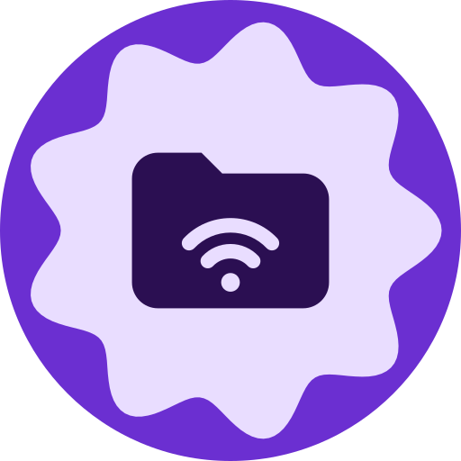
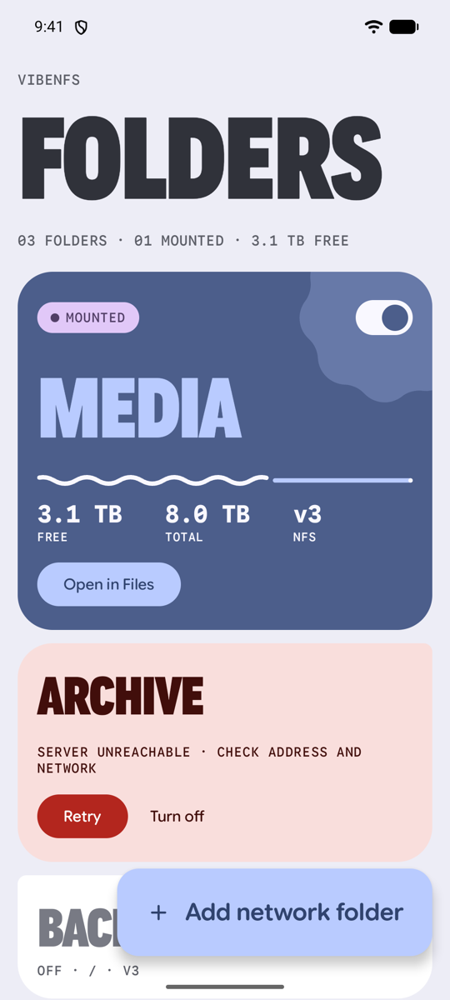
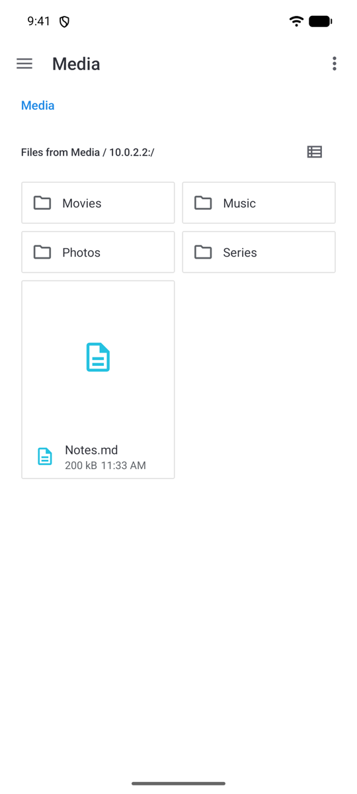
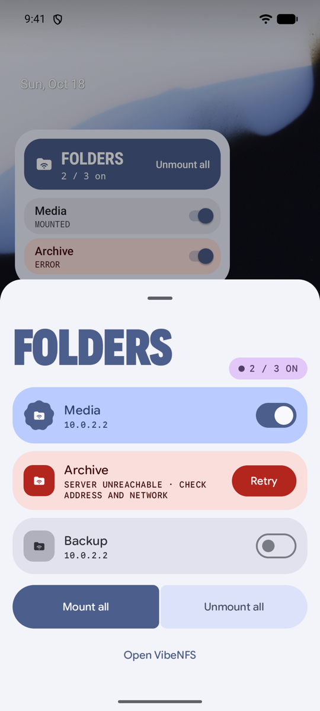
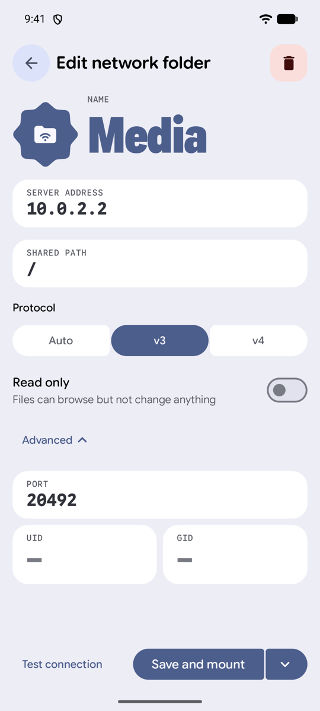
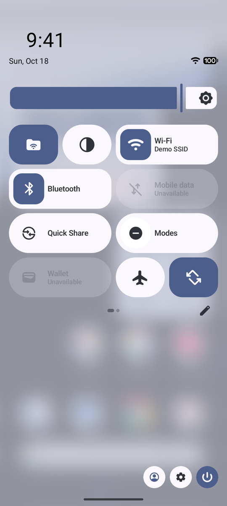
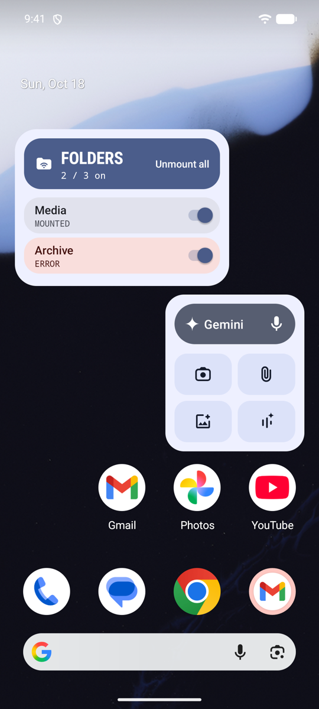
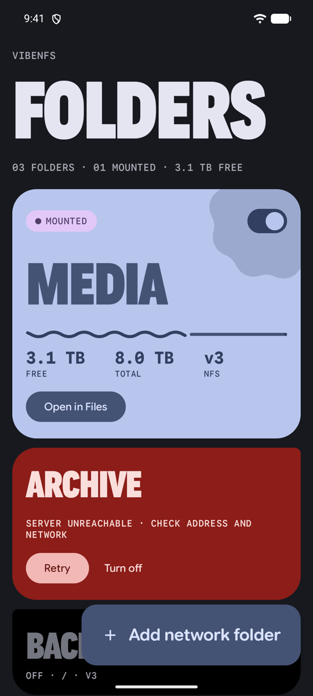

<p align="center"></p>

<h1 align="center">VibeNFS</h1>

<p align="center">
  <strong>A modern NFS client for Android: mount NFSv3 and NFSv4 shares and browse them in the system Files app. No root needed.</strong>
</p>

<p align="center">
  <a href="LICENSE"></a>
  
  
  
  <a href="https://github.com/NicoNex/VibesNFS/releases/tag/latest"></a>
  
</p>

<p align="center">
  
  
  
</p>

---

Your media server, home lab or Linux box already shares folders over NFS. Your Android phone can't open them, because Android doesn't support NFS, and mounting it in the kernel needs root.

**VibeNFS fixes that without root.** Add a network folder once, flip a switch, and the share shows up in the **Files app** next to your internal storage and Google Drive. Any app that opens files through the system picker can then read and save files on your NFS server: video players, photo editors, document apps.

## Features

- **Shows up in the Files app.** Each mounted share appears as its own location in the system file manager, using Android's Storage Access Framework (`DocumentsProvider`). There's no extra file browser to learn.
- **No root, no kernel module.** A native NFS client ([libnfs](https://github.com/sahlberg/libnfs)) runs inside the app.
- **NFSv3 and NFSv4.** *Auto* tries v4 first, since it needs only port 2049 and gets through firewalls more easily, and falls back to v3.
- **Fast, seekable streaming.** Files open as seekable file descriptors served from the network, so you can skip through a 4K movie without downloading it first. Every open file gets its own I/O thread, and libnfs serves concurrent requests over a single connection.
- **Thumbnails in Files.** Photos, videos and album art get previews. VibeNFS uses the preview cameras embed in the photo header when there is one, so most phone photos never cross the network in full just to draw a tile. Otherwise it decodes straight at the requested size. Thumbnails are cached until the file changes.
- **Read and write.** Create, rename, move and delete files and folders from any app. The *Read only* switch protects shares you only want to browse.
- **Quick Settings tile.** Tap to mount or unmount everything. Long-press for a per-folder panel, like the Wi-Fi and Bluetooth tiles.
- **Home screen widget.** The same controls on your home screen, with live status.
- **Finds shares for you.** Type the address of an NFSv3 server and VibeNFS lists its exported paths; tap one to fill in the field. NFSv4-only servers don't publish that list, so type the path yourself.
- **Multiple servers.** Add as many network folders as you want, each with its own protocol, port and UID/GID.
- **Clear errors.** "Server unreachable" or "Access denied by the server" instead of raw RPC codes.
- **Material 3 Expressive.** Big editorial type and expressive shapes and motion. All colors come from your wallpaper (Material You), in light and dark.
- **English and Italian.**

## Screenshots

| Your folders | Edit a folder | In the Files app |
|:---:|:---:|:---:|
|  |  |  |
| **Quick Settings tile** | **Long-press panel** | **Home screen widget** |
|  |  |  |
| **Dark theme** | | |
|  | | |

## Getting started

### 1. Set up your NFS server

Android apps can't open privileged ports (below 1024), and many NFS servers refuse clients that connect from higher ports by default. Allow them on the server:

- **Linux (`/etc/exports`):** add `insecure` to the export, then run `exportfs -ra`.
  ```
  /srv/media  192.168.1.0/24(rw,insecure,no_subtree_check)
  ```
- **Synology DSM:** in the shared folder's NFS permissions, enable *Allow connections from non-privileged ports*.
- **Other servers:** look for an option named "insecure", "non-privileged ports" or "reserved ports".

VibeNFS authenticates with `AUTH_SYS`. To access files as a specific user, set **UID** and **GID** under *Advanced*.

### 2. Install the app

Download **[vibenfs.apk](https://github.com/NicoNex/VibesNFS/releases/download/latest/vibenfs.apk)** from the [latest release](https://github.com/NicoNex/VibesNFS/releases/tag/latest), which is rebuilt automatically from every commit to `master`. You can also build it yourself (see below). The app needs Android 14 or newer.

If the phone refuses to update an earlier install, the two builds were signed by different keys; [docs/signing.md](docs/signing.md) explains why.

### 3. Add a network folder

1. Tap **Add network folder**.
2. Enter the server address. VibeNFS lists the shares it finds; tap one, or type the path yourself.
3. Tap **Test connection**, then **Save and mount**.
4. Open the **Files** app: your folder is in the side menu.

On Android 17, the system asks for permission to access devices on your local network the first time. VibeNFS needs it to reach the server.

## Build from source

Requirements: JDK 21, the Android SDK (compile SDK 37), NDK `29.0.14206865` and CMake `4.1.2`. Gradle downloads everything else.

```sh
# clone with submodules (libnfs lives in app/src/main/cpp/libnfs)
git clone --recursive https://github.com/NicoNex/VibesNFS.git
cd VibesNFS
make debug          # builds vibenfs-debug.apk
make install-debug  # builds and installs on the connected phone
```

| Target | What it does |
|---|---|
| `make apk` | Release APK → `vibenfs.apk` (signed with `keystore.properties` if present, debug key otherwise) |
| `make debug` | Debug APK → `vibenfs-debug.apk` |
| `make test` | JVM unit tests |
| `make install` / `make install-debug` | Build and install on the USB-connected phone |
| `make reinstall` | Uninstall and reinstall, to fix a signature mismatch. Asks before deleting saved folders. |
| `make bundle` | Play Store bundle → `vibenfs.aab` (needs `keystore.properties`) |
| `make release` | Bump `VERSION_CODE`, then build the bundle |

Instrumented tests (`./gradlew connectedDebugAndroidTest`) expect an NFS server reachable from the emulator at `10.0.2.2:20490`. Any userspace server works, for example [go-nfs](https://github.com/willscott/go-nfs): `go run github.com/willscott/go-nfs/example/osnfs <dir> 20490`.

## How it works

```
Files app / any app ──SAF──▶ NfsDocumentsProvider ──▶ MountManager ──▶ NfsClient (JNI) ──▶ libnfs ──TCP──▶ NFS server
                                    │
                                    └─ seekable proxy file descriptors (StorageManager.openProxyFileDescriptor)
```

- **`nfs/`**: a thin JNI bridge over libnfs 8, built with multithreading. One NFS context per share, safe to call from any thread.
- **`mount/`**: keeps track of which folders should be mounted, survives process death and reconnects on demand.
- **`provider/`**: the `DocumentsProvider` that puts each share in the Files app.
- **`provider/Thumbnails.kt`**: previews from the same seekable descriptors, via EXIF, `MediaMetadataRetriever` and `ImageDecoder`.
- **`tile/`, `widget/`, `ui/`**: the Quick Settings tile, the Glance widget and the Compose UI.

## FAQ

**Does it need root?**
No. VibeNFS doesn't use the kernel NFS client. Everything runs in the app.

**Can other apps open my NFS files?**
Yes, any app that uses the system file picker (Storage Access Framework). Apps that only scan local storage directly won't see the share.

**Which NFS versions are supported?**
NFSv3 and NFSv4.0. Kerberos (`sec=krb5`) isn't supported yet.

**Does it keep a connection open in the background?**
No background service or persistent notification. Mounting connects right away. If the app is closed or the network drops, the connection reopens on the next use.

**Is it tested on real NAS hardware?**
Not yet. So far VibeNFS has been tested with NFSv3 against a userspace server on the Android 17 emulator. NFSv4 and real NAS boxes (Synology, TrueNAS, Unraid, Linux `nfsd`) still need testing. Reports are very welcome.

## Roadmap

- F-Droid listing (metadata is ready in `fastlane/`)
- Kerberos authentication

## Contributing

Issues and pull requests are welcome. Reports from real NFS servers help the most: include the server type, the NFS version and what you saw. Run `make test` before opening a pull request.

## License

VibeNFS is free software, licensed under the [GNU General Public License v3.0](LICENSE).

It builds on:
- [libnfs](https://github.com/sahlberg/libnfs) by Ronnie Sahlberg, LGPL-2.1-or-later
- [Google Sans Flex](https://fonts.google.com/specimen/Google+Sans+Flex) and [Google Sans Code](https://fonts.google.com/specimen/Google+Sans+Code), SIL Open Font License 1.1
- [Jetpack Compose](https://developer.android.com/compose), [Material 3](https://m3.material.io) and [Glance](https://developer.android.com/develop/ui/compose/glance), Apache 2.0

<sub>Keywords: NFS client Android, mount NFS share on Android without root, NFSv4 Android, Android Files app NFS, Storage Access Framework NFS, DocumentsProvider NFS, NAS Android file manager, Synology NFS Android, TrueNAS NFS Android, libnfs Android.</sub>
